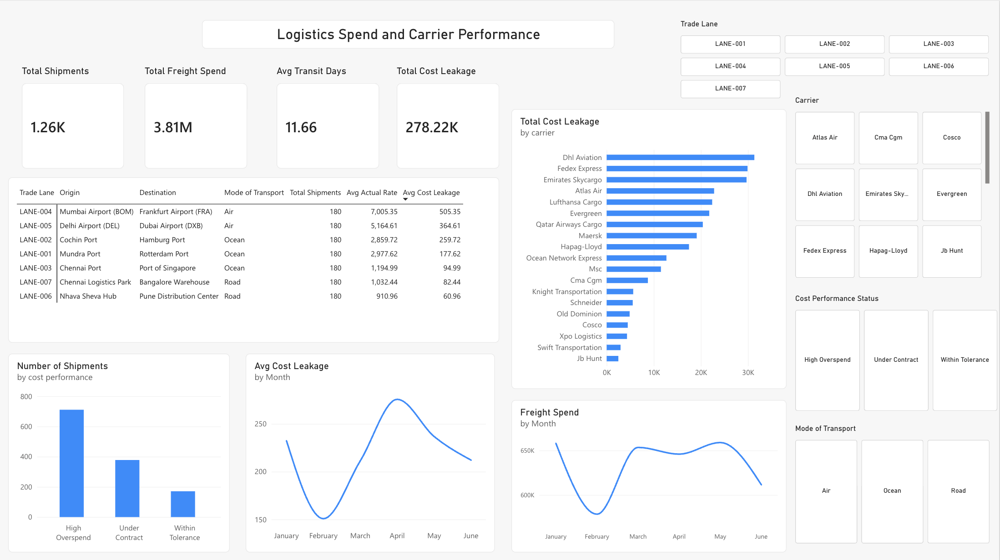
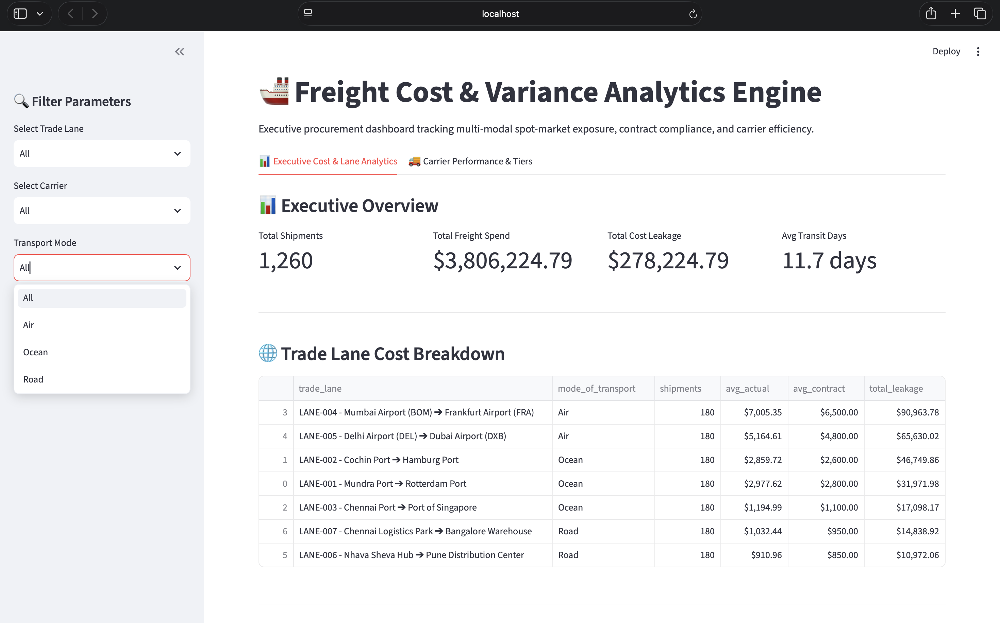
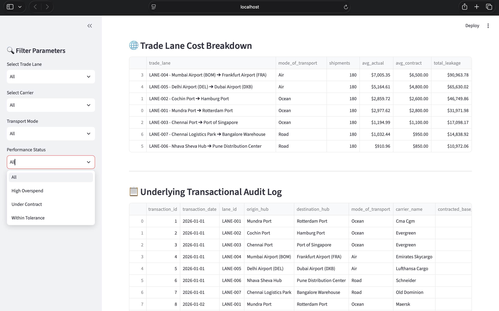

# Freight Cost & Variance Analytics Engine

[](YOUR_DEPLOYED_STREAMLIT_URL_HERE)
[](https://www.python.org/)
[](https://www.postgresql.org/)
[](https://powerbi.microsoft.com/)

An end-to-end supply chain analytics pipeline and dual-frontend control tower designed to track freight spend, detect contract variances, audit carrier service level agreements (SLAs), and eliminate cost leakage across multi-modal transport networks.

---

## 🏢 Business Problem
Shipping operations frequently suffer from invisible financial drainage caused by:
- **Cost Leakage:** Actual rates paid to carriers frequently surpassing pre-negotiated baseline contracts due to unmonitored spot-market exposure.
- **Multi-Modal Blind Spots:** Managing Ocean, Air, and Road transport under a single lens without accounting for structural cost and speed disparities.
- **Vendor Accountability Gaps:** Lack of centralized visibility to penalize underperforming carriers during annual contract (RFP) negotiations.

---

## 🛠️ Tech Stack & Architecture
- **Database & Modeling:** PostgreSQL (Star-Schema Pipeline)
- **Data Engineering & Scripting:** Python, Pandas, SQL
- **Interactive Web App:** Streamlit (Custom Python Dashboard)
- **Enterprise BI:** Power BI Service (Executive Control Tower)
- **Version Control:** Git & GitHub

---

## 🏗️ How It Was Built (Project Flow)

1. **Star-Schema Modeling (PostgreSQL):** Designed a robust relational database structure (`dim_shipping_lanes` and `fact_freight_transactions`) to prevent data anomalies and manage multi-modal shipping logs efficiently.
2. **Data Pipeline & Metrics (Python & SQL):** Cleaned transactional logs and programmatically computed dynamic financial metrics—specifically **Cost Leakage** (`variance_vs_contract_usd`) by subtracting contracted base rates from actual spot rates.
3. **Custom Web Application (Streamlit):** Developed a Python-driven web app (`app.py`) allowing users to interactively query multi-modal shipping performance, view corridor breakdowns, and filter by carrier tiers.
4. **Executive Control Tower (Power BI Service):** Deployed a browser-based analytics dashboard featuring executive KPI summary cards, route-level Trade Lane audit matrices, carrier performance rankings, and monthly cost trend lines.

---

## 📊 Key Features & Visualizations
- **Executive KPI Cards:** Real-time visibility into Total Shipments, Total Freight Spend, Average Transit Days, and Total Cost Leakage.
- **Trade Lane Corridor Matrix:** Detailed route-level auditing (`origin_hub` to `destination_hub`) comparing shipment volume against actual spend and variance.
- **Carrier Performance Ranking:** Horizontal bar charts isolating vendors driving the highest cost overruns and tracking SLA compliance.
- **Multi-Modal Slicers:** Instant dynamic filtering across Ocean, Air, and Road freight.

---

## 🎨 Application Screenshots

### 📊 Power BI Executive Control Tower


### 💻 Streamlit Interactive Web Application




---

## 📂 Project Directory Structure

```text
freight-cost-variance-analytics/
├── assets/
│   ├── powerbi_dashboard.png            # Screenshot of Power BI report
│   ├── streamlit_app_1.png              # Screenshot of Streamlit app view 1
│   └── streamlit_app_2.png              # Screenshot of Streamlit app view 2
│
├── scripts/
│   ├── ingest_freight_data.py           # Python ETL & data ingestion script
│   └── detect_anomalies.py              # Python variance anomaly detection script
│
├── sql/
│   ├── 01_schema.sql                    # PostgreSQL schema creation scripts
│   ├── 02_variance_view.sql             # SQL view for cost variance analysis
│   └── 03_carrier_view.sql              # SQL view for carrier performance
│
├── app.py                               # Streamlit interactive web application
└── README.md                            # Project documentation & portfolio guide
